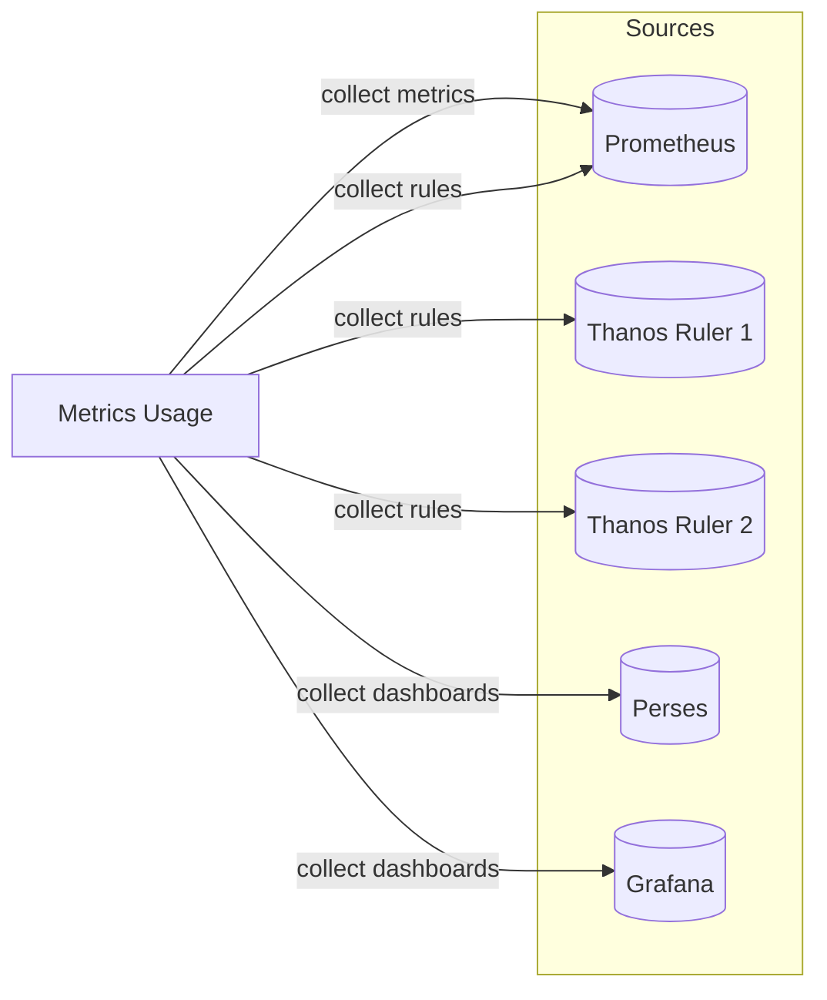
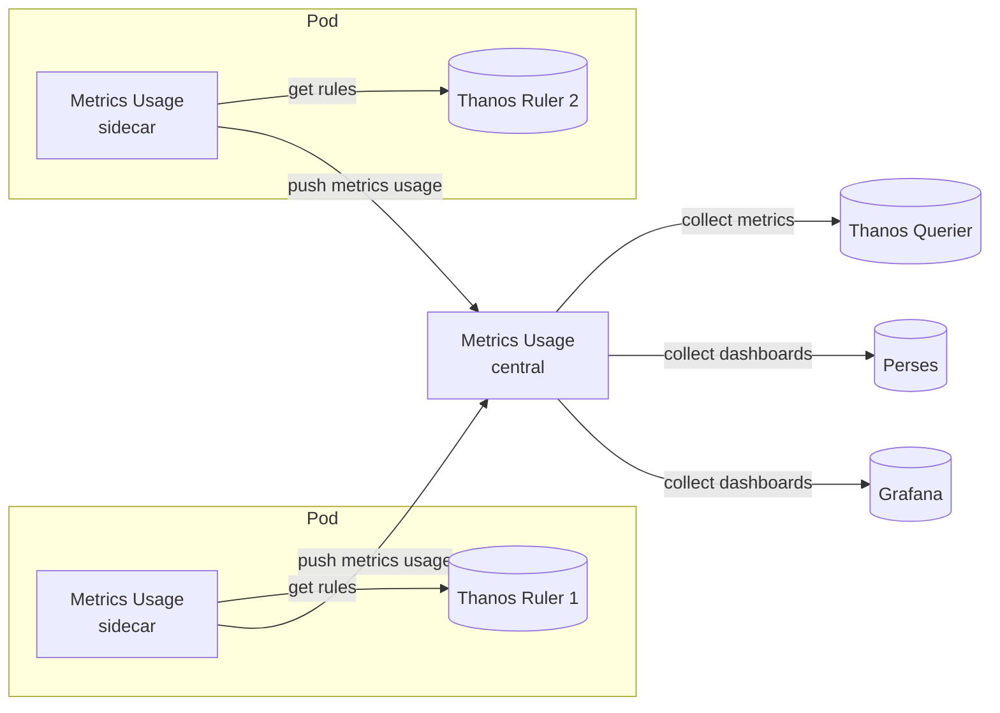

# Deployment

Metrics Usage is a single binary that can play two roles depending on its configuration:

- a **central instance**, which stores the data and exposes the [API](./overview.md#api),
- a **sidecar**, which collects data close to the source and pushes it to a central instance.

These roles can be combined, so you can choose the topology that fits the size of your infrastructure.

## Central instance

In the simplest setup, a single Metrics Usage instance collects everything: the list of metrics, the rules and the
dashboards. It pulls the data directly from each source and keeps it in its own database.



The corresponding configuration:

```yaml
metric_collector:
  enable: true
  http_client:
    url: "https://prometheus.example.com"

rules_collectors:
  - enable: true
    prometheus_client:
      url: "https://prometheus.example.com"
  - enable: true
    prometheus_client:
      url: "https://thanos-ruler1.example.com"
  - enable: true
    prometheus_client:
      url: "https://thanos-ruler2.example.com"

perses_collector:
  enable: true
  perses_client:
    url: "https://perses.example.com"

grafana_collector:
  enable: true
  grafana_client:
    url: "https://grafana.example.com"
```

As the collected data is stateful, you probably want to persist it so it survives a restart. In this case, configure
the [database](./configuration.md#database-config) to be stored in a file, on a persistent volume:

```yaml
database:
  in_memory: false
  path: "/data/metrics-usage.json"
```

## Sidecar for rules collection

In setups with numerous rules (for example many Prometheus or Thanos Ruler instances), collecting everything from a
central instance can become impractical due to the volume of data and the number of endpoints to reach.

Instead, you can deploy Metrics Usage as a sidecar container next to each Prometheus / Thanos Ruler. The sidecar
collects the rules locally, analyzes them, and pushes the resulting usage to the central instance through its API.
The central instance keeps collecting the list of metrics (here from a Thanos Querier) and the dashboards.



The configuration of each sidecar only enables a rules collector with a `metric_usage_client` pointing to the central
instance:

```yaml
rules_collectors:
  - enable: true
    prometheus_client:
      url: "http://localhost:10902"
    # The URL used in the usage to link to the rules. Useful when the rules are reached through localhost.
    public_url: "https://thanos-ruler1.example.com"
    metric_usage_client:
      url: "https://metrics-usage.example.com"
```

The configuration of the central instance doesn't need anything specific to receive the usage pushed by the sidecars:

```yaml
metric_collector:
  enable: true
  http_client:
    url: "https://thanos-querier.example.com"

perses_collector:
  enable: true
  perses_client:
    url: "https://perses.example.com"

grafana_collector:
  enable: true
  grafana_client:
    url: "https://grafana.example.com"
```

The same pattern can be applied to the other collectors: the [labels collector](./configuration.md#labels_collector-config),
the [Perses collector](./configuration.md#perses_collector-config) and the
[Grafana collector](./configuration.md#grafana_collector-config) also support the `metric_usage_client` setting.

> [!NOTE]
> The metric collector doesn't support pushing its data to a remote instance. It must be enabled on the central
> instance, as it builds the list of metrics the usage is associated with.

## Pushing rules from your CI

If your rules are stored in a git repository, you can also push them directly to the central instance from your CI,
without deploying any sidecar. The endpoint `/api/v1/rules` accepts the rule groups in the same format as the
Prometheus API (`/api/v1/rules`), along with the source they come from:

```bash
curl -X POST "https://metrics-usage.example.com/api/v1/rules" \
  -H "Content-Type: application/json" \
  -d '{
    "source": "https://github.com/my-org/my-rules",
    "groups": [
      {
        "name": "node-exporter",
        "file": "node-exporter.yaml",
        "interval": 60,
        "rules": [
          {
            "type": "alerting",
            "name": "NodeCPUHighUsage",
            "query": "sum without (mode) (avg without (cpu) (rate(node_cpu_seconds_total{mode!=\"idle\"}[2m]))) * 100 > 90",
            "duration": 900,
            "labels": {},
            "annotations": {},
            "alerts": [],
            "health": "ok",
            "lastError": "",
            "evaluationTime": 0,
            "lastEvaluation": "0001-01-01T00:00:00Z",
            "state": "inactive"
          }
        ]
      }
    ]
  }'
```
