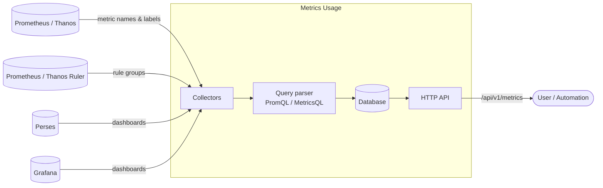

# Overview

Metrics Usage is a tool that analyzes static resources such as dashboards and Prometheus rules to track where and how
the Prometheus metrics are used.

It is especially helpful to find out whether a metric is actually used. Prometheus should ideally not scrape the
metrics nobody uses, as they only add an unnecessary load on the storage and on the queries.

With Metrics Usage, you can answer questions like:

- Which metrics are never used by a dashboard, an alerting rule or a recording rule?
- Which dashboards or rules will break if I drop or rename this metric?
- Which labels are available for a given metric?

## How it works

Metrics Usage is built around a set of **collectors**. Each collector periodically pulls data from a third-party system
and stores the result in a database (in memory or in a JSON file). The data is then exposed through an
[HTTP API](#api).



There are two kinds of collectors:

1. The collectors that build the **list of the existing metrics**: the [metric collector](#metric-collector) and the
   [labels collector](#labels-collector). They query Prometheus to know which metrics exist and which labels they have.
2. The collectors that find the **usage of the metrics**: the [rules collector](#rules-collector), the
   [Perses collector](#perses-collector) and the [Grafana collector](#grafana-collector). They retrieve the queries
   written in the rules or in the dashboards, parse them with the configured
   [query parser](./configuration.md#query_parser-config) and extract the metric names.

The usage is then associated with the metrics returned by the metric collector.

### Metrics, partial metrics and pending usages

When parsing a query, Metrics Usage can end up in three different situations:

- **Metric**: the query references a metric name that is known by the metric collector. The usage is attached to this
  metric. It is available on the endpoint `/api/v1/metrics`.
- **Partial metric**: the metric name cannot be determined exactly because it contains a variable (like
  `node_cpu_${mode}` in a dashboard) or because it is matched with a regexp (like `{__name__=~"node_disk_.+"}`).
  Metrics Usage converts it into a regexp and keeps track of the known metrics matching it. It is available on the
  endpoint `/api/v1/partial_metrics`. You can merge the usage of the partial metrics with the usage of the matching
  metrics using the query parameter `merge_partial_metrics` on `/api/v1/metrics`.
- **Pending usage**: the query references a metric name that is not (yet) known by the metric collector. The usage is
  kept aside and associated with the metric as soon as the metric collector finds it. It is available on the endpoint
  `/api/v1/pending_usages`. Note that a usage may never be associated, for example when the metric doesn't exist
  anymore. It is a good way to find dashboards or rules that are using metrics that are not available.

### Removal of the metrics

A metric that is not returned anymore by the metric collector is not removed immediately. Each time the metric
collector runs, Metrics Usage counts how many consecutive times a metric hasn't been seen. Once this counter reaches the
[database `threshold`](./configuration.md#database-config) (2 by default), the metric is removed from the database.

## Collectors

| Collector                               | Configuration key   | Data retrieved                                                  | Multiple instances |
|-----------------------------------------|---------------------|-----------------------------------------------------------------|--------------------|
| [Metric collector](#metric-collector)   | `metric_collector`  | The list of metrics available in Prometheus                     | No                 |
| [Labels collector](#labels-collector)   | `labels_collectors` | The label names of each metric                                  | Yes                |
| [Rules collector](#rules-collector)     | `rules_collectors`  | The metrics used in the alerting and recording rules            | Yes                |
| [Perses collector](#perses-collector)   | `perses_collector`  | The metrics used in the panels and variables of the dashboards  | No                 |
| [Grafana collector](#grafana-collector) | `grafana_collector` | The metrics used in the panels of the dashboards                | No                 |

### Metric collector

This collector retrieves the list of metrics seen in Prometheus (or any compatible API like Thanos) during the
configured period. These metrics are the reference used to associate the usage found by the other collectors.

```yaml
metric_collector:
  enable: true
  http_client:
    url: "https://prometheus.demo.prometheus.io"
```

> Refer to the complete configuration [here](./configuration.md#metric_collector-config).

### Labels collector

This collector uses the Prometheus HTTP API to retrieve the label names of each metric and enrich the metrics with them.

Multiple labels collectors can be configured for different Prometheus/Thanos instances.

```yaml
labels_collectors:
  - enable: true
    prometheus_client:
      url: "https://prometheus.demo.prometheus.io"
```

> Refer to the complete configuration [here](./configuration.md#labels_collector-config).

### Rules collector

This collector uses the Prometheus HTTP API to retrieve the rule groups and extract the metrics used in the alerting
and recording rules.

Multiple rules collectors can be configured for different Prometheus/Thanos instances.

```yaml
rules_collectors:
  - enable: true
    prometheus_client:
      url: "https://prometheus.demo.prometheus.io"
```

> Refer to the complete configuration [here](./configuration.md#rules_collector-config).

### Perses collector

This collector fetches the dashboards from [Perses](https://perses.dev) through its HTTP API and extracts the metrics
used in the variables and in the panels.

```yaml
perses_collector:
  enable: true
  perses_client:
    url: "https://demo.perses.dev"
```

> Refer to the complete configuration [here](./configuration.md#perses_collector-config).

### Grafana collector

This collector fetches the dashboards from [Grafana](https://grafana.com) through its HTTP API and extracts the metrics
used in the panels.

```yaml
grafana_collector:
  enable: true
  grafana_client:
    url: "https://grafana.example.com"
```

> Refer to the complete configuration [here](./configuration.md#grafana_collector-config).

## API

Metrics Usage exposes the following HTTP endpoints:

| Method   | Endpoint                  | Description                                                                                    |
|----------|---------------------------|------------------------------------------------------------------------------------------------|
| `GET`    | `/api/v1/metrics`         | List the metrics with their usage and labels.                                                  |
| `GET`    | `/api/v1/metrics/{name}`  | Get a single metric.                                                                           |
| `DELETE` | `/api/v1/metrics/{name}`  | Remove a metric from the database.                                                             |
| `POST`   | `/api/v1/metrics`         | Push metrics usage. Used by the collectors configured with a `metric_usage_client`.            |
| `GET`    | `/api/v1/partial_metrics` | List the partial metrics (metrics containing a variable or a regexp) with their usage.         |
| `POST`   | `/api/v1/partial_metrics` | Push partial metrics usage. Used by the collectors configured with a `metric_usage_client`.    |
| `GET`    | `/api/v1/pending_usages`  | List the usage not yet associated with a known metric.                                         |
| `POST`   | `/api/v1/rules`           | Push Prometheus rule groups to be analyzed.                                                    |
| `POST`   | `/api/v1/labels`          | Push the label names of metrics. Used by the labels collectors configured with a `metric_usage_client`. |
| `GET`    | `/metrics`                | Telemetry of Metrics Usage itself, in the Prometheus format.                                   |

### List the metrics

`GET /api/v1/metrics` returns the metrics indexed by name:

```json
{
  "node_cpu_seconds_total": {
    "labels": ["cpu", "instance", "job", "mode"],
    "usage": {
      "dashboards": [
        {
          "uid": "perses/nodeexporterfull",
          "title": "nodeexporterfull",
          "url": "https://demo.perses.dev/api/v1/projects/perses/dashboards/nodeexporterfull"
        }
      ],
      "recordingRules": [
        {
          "prom_link": "https://prometheus.demo.prometheus.io",
          "group_name": "node-exporter.rules",
          "name": "instance:node_num_cpu:sum",
          "expression": "count without (cpu, mode) (node_cpu_seconds_total{job=\"node\",mode=\"idle\"})"
        }
      ],
      "alertRules": [
        {
          "prom_link": "https://prometheus.demo.prometheus.io",
          "group_name": "node-exporter",
          "name": "NodeCPUHighUsage",
          "expression": "sum without (mode) (avg without (cpu) (rate(node_cpu_seconds_total{job=\"node\",mode!=\"idle\"}[2m]))) * 100 > 90"
        }
      ]
    }
  },
  "node_disk_discard_time_seconds_total": {
    "labels": ["device", "instance", "job"]
  }
}
```

A metric without `usage` is not used by any of the dashboards or rules collected.

The following query parameters can be used to filter the list:

- `metric_name`: only return the metrics matching this name. The matching strategy is defined by `mode`.
- `mode`: the matching strategy used with `metric_name`. Possible values:
    - `exact` (default): case-sensitive exact match on the metric name.
    - `fuzzy`: fuzzy match on the metric name.
    - `regex`: regexp match on the metric name.
- `used`: when `true`, only return the metrics that are used. When `false`, only return the metrics that are not used.
  Leave it empty to get both.
- `merge_partial_metrics`: when `true`, the usage of the [partial metrics](#metrics-partial-metrics-and-pending-usages)
  is merged into the usage of the metrics they match.

For example, to get the metrics that are not used at all:

```bash
curl "http://localhost:8080/api/v1/metrics?used=false&merge_partial_metrics=true"
```

### List the partial metrics

`GET /api/v1/partial_metrics` returns the usage of the metrics containing a variable or a regexp, with the list of
known metrics they match:

```json
{
  "node_disk_discard_time_.+": {
    "usage": {
      "alertRules": [
        {
          "prom_link": "https://prometheus.demo.prometheus.io",
          "group_name": "node-exporter",
          "name": "NodeDiskDiscardTimeHigh",
          "expression": "rate({__name__=~\"node_disk_discard_time_.+\"}[5m]) > 1"
        }
      ]
    },
    "matchingMetrics": ["node_disk_discard_time_seconds_total"],
    "matchingRegexp": "^node_disk_discard_time_.+$"
  }
}
```

## What's next

- [Install Metrics Usage](./install.md)
- [Choose how to deploy it](./deployment.md)
- [Configure it](./configuration.md)
